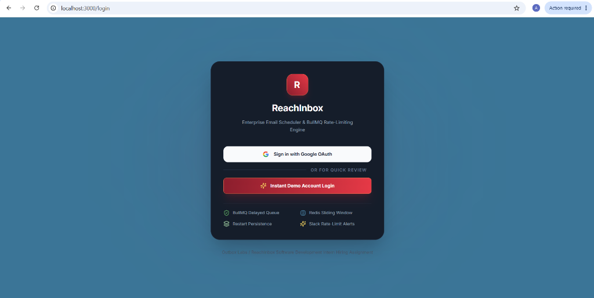
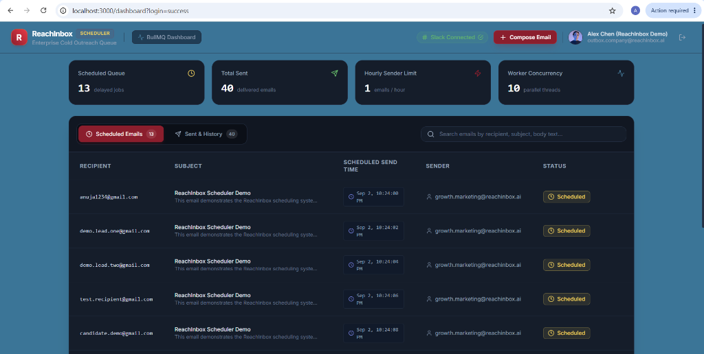
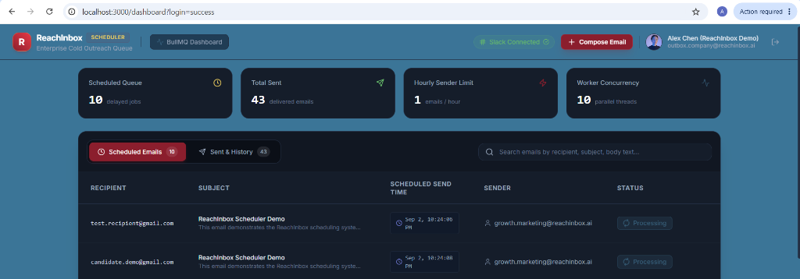
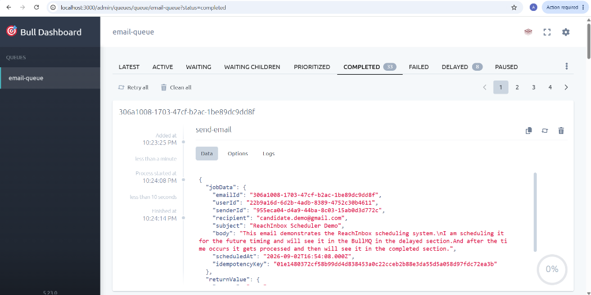
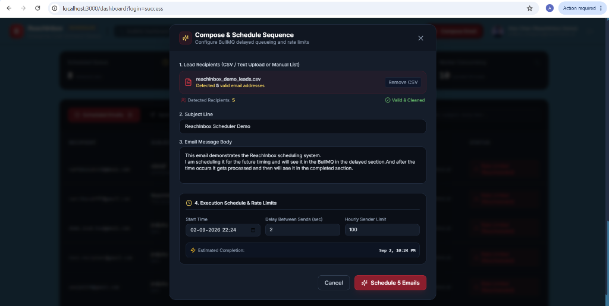

# ReachInbox Email Job Scheduler & Dashboard

A restart-safe email scheduler with a monitoring dashboard, built for the **ReachInbox Hiring Assignment**.

**Stack:** TypeScript, Express.js, BullMQ, Redis, PostgreSQL (Prisma), Elasticsearch, Nodemailer with Ethereal Email, React, Vite, Tailwind CSS.

## Screenshots

### Login



### Dashboard



### Processing



### BullMQ Dashboard



### Compose Email



---

## Design Guarantees

- **No cron jobs.** All scheduling uses BullMQ delayed jobs stored in Redis. There is no `cron`, `node-cron`, `agenda` or polling loop.
- **Restart persistence.** Emails are stored in PostgreSQL and queued in Redis. Jobs that are due while the server is offline run on startup, and future jobs run at their scheduled time.
- **Atomic, multi-worker-safe rate limiting.** Hourly counters and send spacing live in Redis, so they stay correct with several workers. Emails over the limit are delayed into the next hour window, never dropped or failed.
- **Idempotent sending.** The same email is never sent twice (see [Idempotency](#idempotency)).
- **Real Slack alerts.** When a sender's hourly limit is hit, a live message is posted to the user's connected Slack channel.
- **Searchable.** Emails are indexed in Elasticsearch and searchable from the dashboard.

---

## Quick Start

### Prerequisites

- Node.js 18 or newer (tested on Node 24)
- Docker with Docker Compose

### 1. Launch infrastructure

Starts PostgreSQL (host port **5435**), Redis (**6379**) and Elasticsearch (**9200**):

```bash
docker compose up -d
docker compose ps   # wait until all three show "healthy"
```

### 2. Environment configuration

The API reads `.env` from the project root and Prisma reads it from `backend/`, so keep an identical copy in both places.

Windows (PowerShell):

```powershell
copy .env.example .env
copy .env backend\.env
```

macOS / Linux:

```bash
cp .env.example .env && cp .env backend/.env
```

**Ethereal Email:** no setup is needed. When the worker sends its first email it creates a free Ethereal test account automatically and logs a preview link for every message (also shown as an "Ethereal Preview" button in the Sent tab). The `ETHEREAL_*` variables are optional overrides. The `REAL_SMTP_*` variables are only needed for delivery to real inboxes.

**Encryption key:** set `ENCRYPTION_SECRET` to exactly 32 characters. Generate one with:

```bash
node -e "console.log(require('crypto').randomBytes(16).toString('hex'))"
```

### 2b. Google and Slack OAuth credentials

The **Instant Demo Account Login** button works with no credentials. Real Google login and real Slack alerts need the setup below. Put the values in both `.env` files.

**Google OAuth** (Google Cloud Console, Google Auth Platform):

1. Create a project and configure the consent screen (Audience: External).
2. Create an OAuth client of type **Web application**.
3. Add the authorized redirect URI `http://localhost:5000/api/auth/google/callback`.
4. While the app is in Testing mode, add your Google account under **Audience, Test users**.
5. Set `GOOGLE_CLIENT_ID` and `GOOGLE_CLIENT_SECRET`.

**Slack OAuth** (https://api.slack.com/apps, Create New App, From scratch):

1. Under **OAuth & Permissions**, add the redirect URL `http://localhost:5000/api/slack/callback` and click **Save URLs**.
2. Add the Bot Token Scopes `chat:write` and `incoming-webhook`, and turn on **Incoming Webhooks**.
3. Set `SLACK_CLIENT_ID` and `SLACK_CLIENT_SECRET` from **Basic Information, App Credentials**.
4. In the dashboard click **Connect Slack**, choose a channel and allow the app.

Restart the backend after changing `.env`, because nodemon only watches `src/`.

### 3. Install dependencies and set up the database

```bash
# from the project root
npm run setup          # installs backend and frontend dependencies

cd backend
npx prisma generate
npx prisma migrate dev # applies the included migrations
cd ..
```

Run the Prisma commands only after `npm run setup`, from inside `backend/`. Running `npx prisma` before dependencies are installed can download a newer, incompatible Prisma release.

### 4. Run the application

Use three terminals, all from the project root:

```bash
npm run dev:backend    # API server on port 5000
npm run dev:worker     # BullMQ worker (sends the emails)
npm run dev:frontend   # React dashboard on port 3000
```

- Dashboard: http://localhost:3000
- API: http://localhost:5000
- BullMQ dashboard: http://localhost:5000/admin/queues

The worker is a separate process. Without it, emails are scheduled but never sent.

### 5. Run the tests

```bash
npm test                                   # unit tests
npm --prefix backend run test:integration  # integration tests (needs Docker services running, ~20 s)
```

The integration tests use real Redis and BullMQ and cover min-delay spacing, hourly limits, ordering, retries, idempotency and send locking.

---

## Environment Variables

| Variable | Purpose |
| :--- | :--- |
| `PORT`, `CLIENT_URL` | API port (5000) and frontend URL (http://localhost:3000) |
| `DATABASE_URL` | PostgreSQL connection string (host port 5435 with the provided compose file) |
| `REDIS_HOST`, `REDIS_PORT` | Local Redis. `REDIS_URL` overrides them for hosted Redis |
| `ELASTICSEARCH_NODE`, `ELASTICSEARCH_URL` | Elasticsearch address |
| `JWT_SECRET` | Signs the session cookie |
| `ENCRYPTION_SECRET` | 32-character key used to encrypt stored Slack tokens |
| `WORKER_CONCURRENCY` | Parallel jobs per worker (default 10) |
| `DEFAULT_MIN_DELAY_MS` | Minimum delay between sends per sender (default 2000) |
| `DEFAULT_HOURLY_LIMIT` | Emails per hour per sender (default 100) |
| `GOOGLE_CLIENT_ID`, `GOOGLE_CLIENT_SECRET`, `GOOGLE_CALLBACK_URL` | Google OAuth |
| `SLACK_CLIENT_ID`, `SLACK_CLIENT_SECRET`, `SLACK_REDIRECT_URI` | Slack OAuth |
| `ETHEREAL_*`, `REAL_SMTP_*` | Optional SMTP overrides |

---

## Architecture Overview

```
Frontend (React + Vite)
  Google / Demo login, Slack connect, Compose modal (CSV upload),
  Scheduled and Sent tables, search
        |  REST + HttpOnly JWT cookie
        v
Backend API (Express)
  Auth  |  Schedule endpoint  |  Slack OAuth  |  Search  |  BullBoard (/admin/queues)
        |                          |                          |
        v                          v                          v
  PostgreSQL                Redis / BullMQ              Elasticsearch
  users, senders,           delayed jobs, rate          searchable email
  emails, Slack tokens      limit counters              index
                                   |
                                   v
                         BullMQ Worker (separate process)
  1. Pick up a due job, move the email to PROCESSING in PostgreSQL
  2. Reserve a send slot for the sender in Redis (min-delay spacing + hourly limit)
       - slot is in the future: defer the job to that time
       - hourly limit reached: defer to the next hour window, mark RATE_LIMITED,
         post one Slack alert (if Slack is connected)
       - otherwise: send now
  3. Send via SMTP (Ethereal), mark SENT with the provider message ID
  4. Index the email in Elasticsearch
```

### How scheduling works

When emails are scheduled, each one is saved in PostgreSQL and added to the BullMQ queue as a delayed job. The job ID is the email's database ID. Redis holds the delayed jobs and releases each one when its time arrives.

### How persistence on restart works

Both PostgreSQL and Redis are durable, so stopping the API or worker loses nothing. When the API starts it runs a reconciliation check that fixes emails left in a half-finished state. Delayed jobs stay in Redis, so future emails still go out at the right time, and the idempotency checks below stop repeats.

### Worker concurrency

The worker runs `WORKER_CONCURRENCY` jobs in parallel (default 10). Spacing and rate limits are tracked in Redis rather than in worker memory, so parallel jobs and multiple worker instances stay correct.

### Delay between emails

**Minimum 2 seconds between sends per sender** by default (`DEFAULT_MIN_DELAY_MS=2000`). It can also be set per batch from the Compose form (Delay Between Sends). The worker does not sleep. Each job reserves the sender's next free slot in Redis, and a job whose slot is in the future is deferred until then, so concurrent jobs end up spaced out instead of sending in a burst.

### Hourly rate limit

**100 emails per hour per sender** by default (`DEFAULT_HOURLY_LIMIT=100`), configurable from the Compose form (Hourly Sender Limit) or env. Counters are kept in Redis per sender and per UTC hour window and updated atomically (Lua script), so they are safe across workers. When a sender hits the limit:

- the job is **not** dropped or failed. It is deferred to the next hour window, and the email shows as **Rate Limited (Rescheduled)** in the dashboard
- overflow beyond one window spills into the following windows
- jobs keep their original order (each later job lands a few milliseconds after the previous one in its window)
- one Slack alert is posted for the limit hit

### Multiple senders

A user can have several senders. Each sender has its own hourly limit and its own minimum delay between sends, and the rate limiter counts each sender separately, so one sender hitting its limit does not slow the others.

- The Compose form has a **Send From** dropdown and an **Add sender** option.
- `GET /api/emails/senders` lists the user's active senders and `POST /api/emails/senders` creates one.
- `POST /api/emails/schedule` accepts an optional `senderId`. If it is missing, or does not belong to the user, the user's first active sender is used.
- The hourly limit and delay entered in the Compose form are saved on the chosen sender.
- The Slack alert names the sender that hit its limit.

### Behaviour under load (1000+ emails at the same time)

All 1000+ emails are stored and queued. The sender's slots are handed out one after another, so sends are spread at the minimum delay instead of firing together, and at most `WORKER_CONCURRENCY` jobs run at once. Once the hourly limit is reached, the remaining jobs are deferred to the next windows in order. Nothing is lost, because every job lives in Redis and PostgreSQL, and a restart in the middle changes nothing.

### Idempotency

1. **Deterministic job IDs.** The BullMQ job ID equals the email's database ID, so re-adding the same email does not create a second job.
2. **Atomic state check.** The worker only starts an email if it is still in a sendable state. Emails already marked SENT are skipped.
3. **Provider message ID marker.** After a successful send the SMTP message ID is recorded. If the send succeeded but the database update was lost, the next attempt finds the marker, repairs the database and does not send again.
4. **Send lock.** If another run is already sending the same email, the job waits and re-checks instead of double-sending.

### Search

Sent and scheduled emails are indexed in Elasticsearch (recipient, subject, body). The dashboard search box queries it, with a fallback to PostgreSQL `ILIKE` if Elasticsearch is unavailable.

### Slack notifications

Slack tokens are stored encrypted per user. If a user has not connected Slack, rate-limit hits simply skip notification with no error. If they connect later, notifications start working without a redeploy.

---

## API Reference

All routes except login and callbacks need the session cookie.

| Method | Route | Purpose |
| :--- | :--- | :--- |
| GET | `/api/auth/google` | Start Google login |
| GET | `/api/auth/google/callback` | Google redirect target, sets the session cookie |
| POST | `/api/auth/demo` | Demo login |
| GET | `/api/auth/me` | Current user, senders and Slack status |
| POST | `/api/auth/logout` | Clear the session |
| POST | `/api/emails/schedule` | Schedule emails (recipients, subject, body, scheduledAt, optional senderId, maxEmailsPerHour, minDelayMsBetweenSend) |
| GET | `/api/emails/scheduled` | Paginated scheduled emails |
| GET | `/api/emails/sent` | Paginated sent and failed emails |
| GET | `/api/emails/search` | Search emails (Elasticsearch) |
| GET | `/api/emails/senders` | List senders |
| POST | `/api/emails/senders` | Create a sender |
| GET | `/api/slack/connect` | Start Slack OAuth |
| GET | `/api/slack/status` | Slack connection status |
| POST | `/api/slack/disconnect` | Disconnect Slack |

## Features Implemented

**Backend**

| Feature | Source |
| :--- | :--- |
| BullMQ delayed-job scheduling, no cron | `backend/src/queue/emailQueue.ts` |
| Worker, concurrency, retries | `backend/src/queue/worker.ts` |
| Atomic Redis rate limiter and send spacing | `backend/src/services/rateLimiterService.ts` |
| Ethereal SMTP sending | `backend/src/services/etherealService.ts`, `emailService.ts` |
| Slack OAuth and rate-limit alerts | `backend/src/controllers/slackController.ts`, `services/slackService.ts` |
| Google OAuth and JWT sessions | `backend/src/controllers/authController.ts`, `services/authService.ts` |
| Elasticsearch indexing and search | `backend/src/services/elasticsearchService.ts` |
| Live queue dashboard (BullBoard) | `backend/src/app.ts` (`/admin/queues`) |
| Restart reconciliation | `backend/src/server.ts` |
| Unit and integration tests | `backend/src/__tests__/` |

**Frontend**

| Feature | Source |
| :--- | :--- |
| Google login, demo login | `frontend/src/pages/LoginPage.tsx`, `hooks/useAuth.tsx` |
| Header with name, email, avatar, logout | `frontend/src/components/layout/Header.tsx` |
| Compose modal: subject, body, CSV upload with detected count, start time, delay, hourly limit | `frontend/src/components/compose/ComposeModal.tsx`, `hooks/useCsvParser.ts` |
| Scheduled and Sent tables with status badges, empty states, Ethereal preview links | `frontend/src/components/dashboard/` |
| Search | `frontend/src/components/dashboard/SearchBar.tsx` |
| Slack connect and status | `frontend/src/pages/SettingsPage.tsx` |

---

## Demo and Restart Verification

1. **Login:** open http://localhost:3000 and click **Sign in with Google OAuth** (or **Instant Demo Account Login**).
2. **Schedule:** click **Compose Email**, add recipients (paste or upload a CSV), set the start time a few minutes ahead, then click **Schedule**.
3. **Watch the queue:** open http://localhost:5000/admin/queues.
4. **Restart test:**
   - Stop the backend and worker (`Ctrl+C` in both terminals).
   - Start them again (`npm run dev:backend`, `npm run dev:worker`).
   - The email is still under Scheduled Emails and is sent once at its scheduled time.
5. **Rate limit and Slack:** connect Slack, then schedule 3 emails with **Hourly Sender Limit = 1**. The first email is sent, the other two show **Rate Limited (Rescheduled)** and a live alert arrives in your Slack channel.

---

## Assumptions, Shortcuts and Trade-offs

- **Fixed hourly windows.** Limits are counted per UTC clock hour, not a rolling 60 minutes. This is simple and atomic, but a sender can use its full limit at the end of one hour and again at the start of the next.
- **Ethereal is a fake inbox.** Messages are caught by Ethereal and never reach real addresses unless `REAL_SMTP_*` is configured.
- **Demo login is a convenience.** Real Google OAuth is also implemented. While the Google app is in Testing mode, only accounts listed as test users can sign in.
- **Slack alert per limit hit, not per email.** One message is sent when a sender hits the limit, not one per delayed email.
- **Timing test sensitivity.** The min-delay integration test allows 30 ms of timer jitter. On a busy machine it can fail occasionally. Re-running it passes.
- **Local setup.** The project is documented for local Docker use. `render.yaml` and `frontend/vercel.json` are included for optional deployment.
- **Dependencies.** `npm audit` reports advisories in some transitive packages. They were left unchanged to avoid breaking upgrades.

---

## Troubleshooting

| Problem | Fix |
| :--- | :--- |
| `prisma generate` says it is a Prisma 8 command | Run `npm run setup` first, then run Prisma from `backend/` |
| Google error `invalid_client` showing `your_google_client_id_here` | The root `.env` still has the placeholder. Put the real values in both `.env` files and restart the backend |
| Slack error "redirect_uri did not match" | Add `http://localhost:5000/api/slack/callback` under OAuth and Permissions and click **Save URLs** |
| `P1000` or `P1001` from Prisma | Check `docker compose ps` and that `DATABASE_URL` uses port 5435 and the password from `docker-compose.yml` |
| Emails stay scheduled and never send | The worker is not running. Start `npm run dev:worker` |